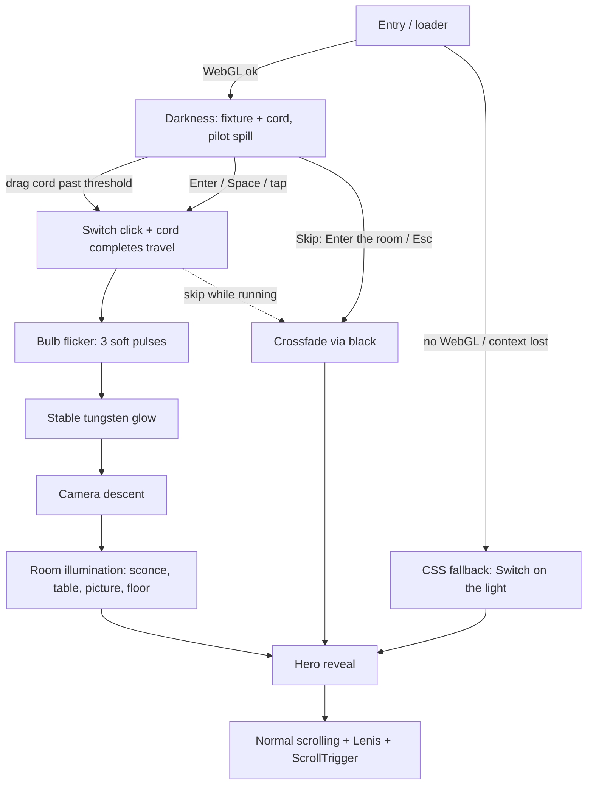

# Wahdia Lights — design specification & opening-experience notes

Brand name, copy and catalogue live in `index.html` and `src/content.js` (all placeholders).

## Atmosphere
A heritage lighting atelier in a 1920s European townhouse at night. Aged brass, dark walnut, plaster, frosted glass, warm tungsten. Film grain + soft vignette. Catalogue typography: Cormorant Garamond (self-hosted via `@fontsource`), uppercase letter-spaced labels, italic for voice.

References studied for *interaction quality only* (not theme): AETumi (product-first 3D vs. commerce balance), Blenra (single continuous WebGL scene, camera choreography), Edifio Adidas 3D (scroll-linked camera + UI), Awwwards e-commerce. Note: they were not opened live in this build session, so the takeaways are applied principles (one continuous scene, scroll-linked camera push, 3D that is lazy and secondary to commerce), not copied behaviour.

## Palette
| token | hex | use |
|---|---|---|
| ivory | `#E9DDC7` | text on dark |
| parchment | `#D6C4A5` | secondary text, paper section |
| brass | `#A7834E` (hi `#CFA968`) | rules, buttons, labels |
| tobacco | `#4B3023` | timber, furniture |
| oxblood | `#4A2024` | rug, curtains, featured section |
| walnut | `#211812` | page background |
| amber | `#FFBE68` | light colour, emphasis |

## Room & lights (metres; room x ±3, z −3.5…3.5, ceiling 3.0)
| light | position | role | peak (cd) |
|---|---|---|---|
| ceiling fixture | (0, 2.83, −1.2) | key light, only shadow caster | 15 |
| wall sconce | (−1.4, 1.97, −3.3) | warm accent, left of painting | 4.2 |
| table lamp | (1.0, 1.4, −3.2) | **focal point**, right third | 7.5 |
| picture light | spot above frame | rakes plaster texture | 24 |
| floor lamp | (2.5, 1.58, −2.95) | warms far right corner | 7 |
| pilot spill | (−1.6, 1.7, 1.6) | faint hallway glow so the cord reads in "darkness"; fades out | 3.2 |

Colour temperature is per-lamp: a filament starts ember-orange and warms to `#FFBE68` as power rises.

## Camera path
Catmull-Rom through 4 keyframes (+ a matching look-at curve), FOV 54° → 43°:
`(0.04,1.92,0.5)` looking up at the fixture → `(0.12,1.9,1.15)` → `(0.2,1.72,2.0)` → `(0.05,1.52,2.95)` wide hero. Portrait screens use a lower look-at and wider FOV. One parameter `cam.t` (0→1) is tweened; the scene never cuts.

## Interaction state machine
`loading → dark ⇄ dragging → triggered → flicker → descent → illuminate → free`
(skip: any pre-`free` state → crossfade via black → `free`)

## Timeline (seconds after the switch fires)
| t | event |
|---|---|
| 0.0 | click (synthesised Web Audio), invite text + skip fade out |
| 0.4–1.6 | three weak, irregular flicker pulses (≥0.4 s apart, never full-field), then ceiling settles to full over 0.75 s |
| 1.9–7.5 | camera descent (`power2.inOut`) |
| 3.7–6.3 | sconce (with a tiny stutter) → table lamp → picture light → floor lamp |
| 6.7–8.6 | hero eyebrow / headline / lede / CTAs reveal, scroll unlocks (~8.7 s total) |

## Reduced motion
Cord still works. No flicker, no breathing, no parallax, no grain animation; lights fade up over ~1.2 s while the camera eases to the hero in 1.4 s; hero fades in.

## Loading, fallback
Everything is generated at start-up (canvas textures, geometry): no remote or binary assets. A loader shows until the first frame. If WebGL is unavailable (or the context is lost) a CSS opening takes over: dark page, "Switch on the light" button, glow, same hero. Plates / before-after / inspector degrade independently.

## Performance
DPR capped (2 desktop, 1.5 touch/small), static shadow map (rendered once, one point light), render loop sleeps when the hero is off-screen, the tab is hidden, or nothing is animating; adaptive pixel-ratio drop if the descent runs slow. Plates and the inspector are lazy (IntersectionObserver) and use their own small contexts.

## Landing-page order
Hero (live scene) → I Collection (live-rendered plates, parchment paper) → II Craft (material specimens) → III Light transforms a room (before/after dimmer from captured stills of the real scene) → IV Featured fixture (OrbitControls inspector) → Footer.

## Opening experience flow (matches the code)

## Update: WADIA brand, video pipeline
- **Brand:** WADIA · Lights & Automation. Logo lockup (yellow line-art bulb, dotted rule, grey WADIA with a yellow D) is HTML/CSS/inline SVG (`.logo`), reused in the nav, intro, loader and footer. Palette follows the logo: signal yellow `#F5B800`, graphite greys, white. Type: Barlow Condensed (display, buttons, labels) + Barlow (body), self-hosted via `@fontsource`.
- **Loader:** the logo bulb draws itself, then glows (CSS only, ~1.9 s).
- **Films:** everything that was live WebGL (intro, hero, comparison, plates, craft, turntable) is now pre-rendered video in `public/videos/` (see its README). `npm run dev`, then `node tools/render-all.mjs` re-renders them. The live WebGL scene (`src/experience.js`) is only loaded, on demand, if the videos cannot play.
- **Intro:** `intro-pull` (all-intra) is scrubbed by dragging the cord; past 60 % it plays on, `intro` takes over, then `hero` loops. Skip crossfades straight to `hero`.
- **Tests:** `node tools/test-site.mjs desktop|mobile` drives real Chrome through the whole flow and saves screenshots.
